<div align="center">



<p>
  <a href="https://aysenurakkayagul-com.vercel.app"></a>
  
  
  
</p>

<p><em>A refined, bilingual portfolio for an academic: research, publications, courses, awards and talks,<br>
with papers and the CV readable right in the browser.</em></p>

</div>


## What it is

A portfolio designed for academics, researchers and educators. Everything lives in one central data file, so the content can be updated in both languages without touching the components.

| | |
|---|---|
| **Bilingual** | Switch between English and Turkish from one data structure. |
| **Dark and light** | Follows the system and can be toggled by hand. |
| **Animated statistics** | Years of experience, publications, programmes and graduates as counters. |
| **PDF viewer** | Papers, journals and the CV previewed in the page with `react-pdf`. |
| **Notes and blog** | Short articles and talk notes written in Markdown. |
| **Academic sections** | Courses taught, awards and honours, conference talks and media. |
| **Motion** | Scroll reveals and micro-interactions with Framer Motion, plus a subtle 3D accent. |


## One data file, every section

All content lives in `data.ts`, once per language. Adding a paper or a talk is an edit to that file, never to a component.

| Section | Holds |
|---|---|
| **About · affiliations** | Biography, institutions and an ORCID link |
| **Research · projects · theses** | Research areas, funded projects and supervised theses |
| **Teaching** | Courses and programmes taught |
| **Talks** | Conference talks and invited lectures |
| **Experience** | Academic and professional positions |
| **Awards · certificates** | Honours and certifications, each viewable in place |
| **Gallery · blog** | Photos and Markdown notes |
| **Contact** | A form delivered through EmailJS |


## Türkçe özet

Akademisyenler, araştırmacılar ve eğitimciler için hazırlanmış iki dilli bir portfolyo sitesi. Araştırmalar, yayınlar, verilen dersler, ödüller ve konuşmalar tek bir veri dosyasından yönetiliyor. Makaleler ve özgeçmiş tarayıcıda PDF olarak açılıyor; Markdown ile notlar ve kısa yazılar paylaşılabiliyor. Açık ve koyu tema, Türkçe ve İngilizce arayüz var.


## Development

```sh
npm install
npm run dev      # needs VITE_EMAILJS_SERVICE_ID, VITE_EMAILJS_TEMPLATE_ID, VITE_EMAILJS_PUBLIC_KEY for the form
npm run build
```

```
data.ts        all content, in both languages
App.tsx        pages and sections
components/    3D scene and diagrams
public/        CV and documents
```

<div align="center">
<br>
<a href="https://github.com/kutluhangil"></a>
<sub>Built with care for a life in research and teaching · the figures in the banner are placeholders.</sub>
</div>
